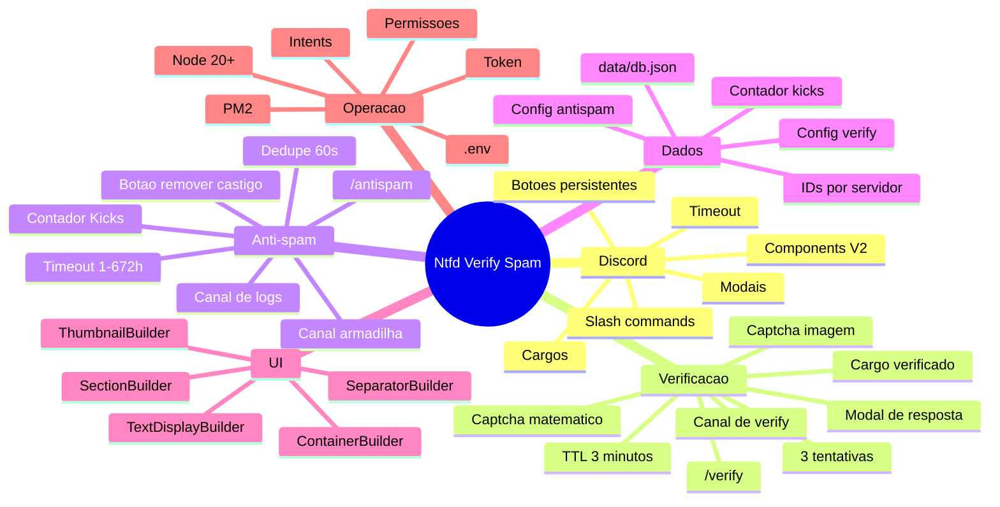
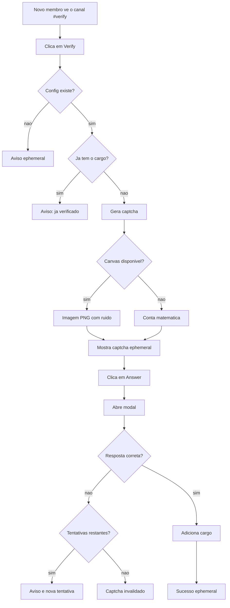
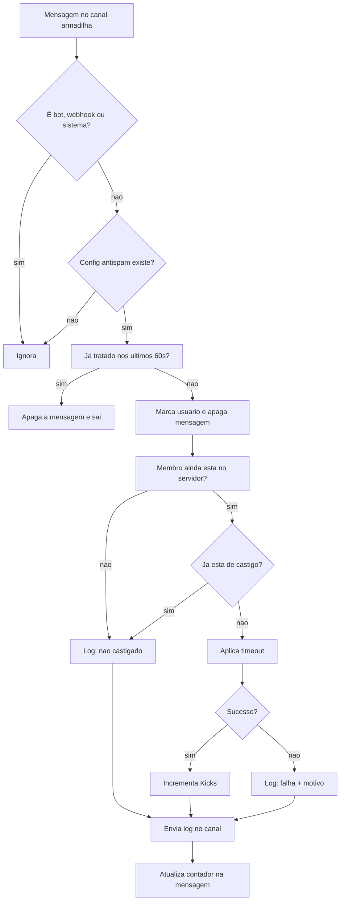
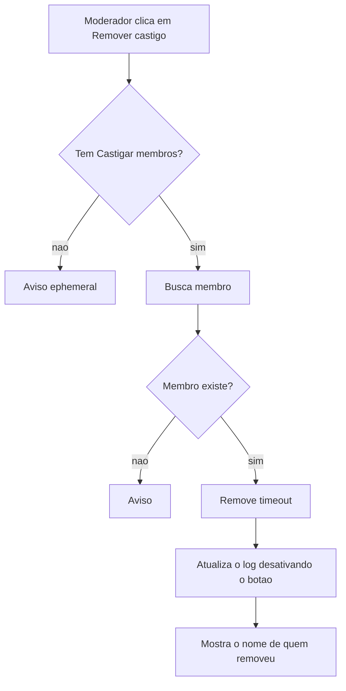

# Mapa mental — Ntfd Verify Spam

> Documento de arquitetura e operação do bot, do `/verify` ao botão **Remover castigo**.
> Estado atual: **v1.0.0**, Node **20+**, discord.js 14.27.

---

## 1. Visão geral (mind map)



---

## 2. Fluxo de verificação



### Regras

- Captcha expira em **3 minutos**.
- Máximo de **3 tentativas**.
- Resposta comparada em maiúsculas.
- O cargo precisa existir e estar abaixo do cargo do bot.
- O painel é público; o captcha e as respostas são **ephemeral**.

---

## 3. Fluxo do anti-spam



### Regras

- Timeout padrão: **168 horas (7 dias)**.
- Limite do Discord: **672 horas (28 dias)**.
- Rajadas: todas as mensagens são apagadas, mas só uma punição/log por 60 s.
- Donos, administradores e cargos acima do bot não podem ser castigados; a mensagem ainda é apagada e o log registra o motivo.
- Bots, webhooks e mensagens de sistema são ignorados.

---

## 4. Remover castigo



- O botão fica dentro do Components V2 do log.
- A estrutura do container é copiada e o botão é desativado.
- Se a atualização falhar, o bot responde em ephemeral que o castigo foi removido.

---

## 5. Estrutura de arquivos

```text
discord-bot/
├─ src/
│  ├─ index.js                   Entrada, intents e registro dos comandos
│  ├─ config.js                  Token, idioma, guild de desenvolvimento
│  ├─ storage.js                 JSON atômico em data/db.json
│  ├─ messages.js                Textos en / pt
│  ├─ ui.js                      Helpers de Components V2
│  ├─ commands/
│  │  ├─ index.js                Collection e JSON dos comandos
│  │  ├─ verify.js               /verify
│  │  └─ antispam.js             /antispam
│  ├─ events/
│  │  ├─ interactionCreate.js    Comandos, botões e modais
│  │  └─ messageCreate.js        Canal armadilha
│  └─ services/
│     ├─ verification.js         Captcha, tentativas e cargo
│     ├─ captcha.js              Imagem ou matemático
│     └─ antispam.js             Timeout, logs, kicks e remoção
├─ data/                         Banco local (não versionar)
├─ .env.example
├─ package.json
└─ README.md
```

| Arquivo | Responsabilidade |
|---|---|
| `src/index.js` | Cria o Client, registra eventos e comandos |
| `src/storage.js` | Carrega, valida e salva o JSON por servidor |
| `src/services/verification.js` | Estado dos captchas e entrega do cargo |
| `src/services/captcha.js` | Geração de imagem/matemático e fallback |
| `src/services/antispam.js` | Punição, log, contador e remoção |
| `src/events/messageCreate.js` | Filtra bots/webhooks e chama o anti-spam |
| `src/events/interactionCreate.js` | Roteia slash, botões e modais |
| `src/ui.js` | Container, seções, separadores e thumbnails |

---

## 6. Comandos e permissões

| Comando | Opções | Permissão padrão |
|---|---|---|
| `/verify` | `canal`, `cargo` | Gerenciar servidor |
| `/antispam` | `canal`, `canal_logs?`, `duracao_horas?` | Gerenciar servidor |

### Permissões do bot

| Permissão | Uso |
|---|---|
| Ver canais | Ver o canal de verificação, armadilha e logs |
| Enviar mensagens | Painéis, captcha e logs |
| Inserir links | Components V2 e anexos |
| Ler histórico | Atualizar o contador no canal armadilha |
| Gerenciar mensagens | Apagar mensagens do spammer |
| Gerenciar cargos | Entregar o cargo de verificado |
| Gerenciar canais | Criar `#antispam-logs` (opcional) |
| Castigar membros | Aplicar/remover timeout |

> O cargo do bot precisa estar acima do cargo de verificado e dos cargos dos usuários que ele deve punir.

---

## 7. Armazenamento

Arquivo: `data/db.json` (criado automaticamente).

```json
{
  "<guildId>": {
    "verify": {
      "channelId": "...",
      "roleId": "...",
      "messageId": "..."
    },
    "antispam": {
      "channelId": "...",
      "logChannelId": "...",
      "messageId": "...",
      "durationHours": 168,
      "kicks": 0
    }
  }
}
```

- `storage.js` grava em `db.json.tmp` e renomeia para `db.json` (evita arquivo pela metade).
- Se o JSON estiver corrompido, cria um backup `db.corrompido-<timestamp>.json` e começa vazio.
- `data/` é ignorado pelo Git.

---

## 8. UI — Components V2

- `ContainerBuilder` sem cor de destaque (sem linha lateral).
- `SectionBuilder` com texto e thumbnail do avatar.
- `TextDisplayBuilder` para o conteúdo.
- `SeparatorBuilder` para separar blocos do log.
- `MessageFlags.IsComponentsV2` em todos os painéis.
- Botões usam `customId`, então continuam funcionando após reiniciar.

---

## 9. Deploy

### Local

```bash
npm install
copy .env.example .env
npm start
```

### PM2

```bash
npm install -g pm2
pm2 start src/index.js --name ntfd-verify-spam
pm2 save
pm2 startup
```

### Hospedagem

- Node 20+.
- `MAIN=src/index.js`.
- Sem porta HTTP; é um bot de gateway.
- `data/db.json` precisa ser gravável e persistente.
- `@napi-rs/canvas` é opcional.
- Em Linux, para captcha em imagem: `fontconfig` + `fonts-dejavu-core`.

---

## 10. Segurança

- `.env` nunca vai para o Git.
- `data/` nunca vai para o Git.
- Token exposto = reset imediato no Developer Portal.
- Não dar Administrador ao bot; usar apenas as permissões da tabela.
- `Message Content Intent` é opcional e só deve ser ativada para gravar o texto do spammer.
- O botão **Remover castigo** exige **Castigar membros**.

---

## 11. Limitações e observações

- O anti-spam pune qualquer humano que escrever no canal armadilha, inclusive por engano; use o botão de remoção.
- O Discord não permite castigar donos, administradores ou cargos acima do bot.
- Se o canal de logs for apagado, rode `/antispam` novamente.
- Se a mensagem do canal armadilha for apagada, o contador não pode ser atualizado até reconfigurar.
- O captcha matemático é mais fraco que o de imagem, mas garante funcionamento sem canvas/fontes.
- O armazenamento JSON é adequado para um processo; para múltiplas instâncias, seria necessário um banco compartilhado.
